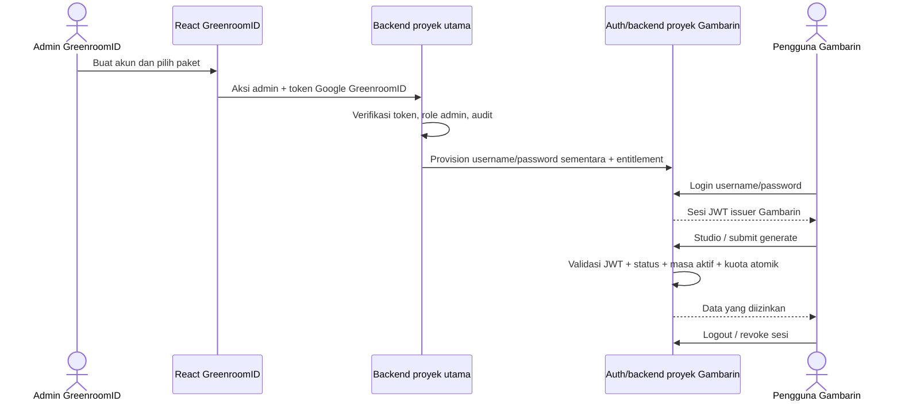

# Arsitektur Autentikasi Gambarin AI (MVP)

Status: **REKOMENDASI — menunggu persetujuan Project Owner; belum menjadi keputusan final.** Desain ini berdasarkan pemeriksaan kode dan berkas SQL lokal pada 26 Oktober 2026. Kondisi database produksi belum diperiksa.

## 1. Rekomendasi

Gunakan **proyek Supabase khusus Gambarin AI** sebagai issuer Supabase Auth terpisah, dan satu modul fitur di aplikasi React yang sama. Akun Gambarin memakai username + password dan hanya diprovisikan admin melalui backend. Jangan membuat akun Gambarin pada proyek Supabase GreenroomID utama.

Token Gambarin tidak boleh diterima oleh API/database proyek utama: issuer/signing key proyek berbeda, sehingga klaim `authenticated` Gambarin bukan identitas GreenroomID. Endpoint Gambarin yang memerlukan data harus memvalidasi token terhadap proyek Gambarin lalu melakukan otorisasi sisi server; akses data GreenroomID tetap memerlukan sesi GreenroomID. Admin Gambarin di UI utama tetap memakai sesi Google GreenroomID dan setiap aksi admin harus diverifikasi server-side.

Pilihan ini memerlukan proyek dan konfigurasi Supabase tambahan. **UNVERIFIED:** ketersediaan resource, kuota, batas proyek aktif, perilaku pause, dan biaya pada paket Supabase Free akun produksi. Jangan implementasikan sebelum Project Owner menyetujui trade-off dan konfigurasi lintas proyek.

## 2. Perbandingan pendekatan

| Pendekatan | Isolasi | Keamanan/kewajiban | Biaya dan pemeliharaan | Kesimpulan |
| --- | --- | --- | --- | --- |
| A. Supabase Auth proyek utama dengan client/storage terpisah | Tidak terisolasi dari RLS/API proyek utama. JWT kedua sesi tetap menjadi role `authenticated` pada proyek yang sama. | Hash password dan sesi ditangani Supabase, tetapi seluruh policy dan endpoint utama harus membedakan setiap identitas Gambarin; itu mengubah batas kepercayaan aplikasi induk. | Paling sedikit resource, tetapi berisiko tinggi dan berdampak pada aturan lama. | Ditolak. `storageKey` bukan batas keamanan. |
| B. Auth custom di backend Gambarin pada proyek utama | Bisa tidak memberi JWT Supabase kepada browser; hanya backend dipercaya. | Tim harus merawat hashing password, sesi opaque, penyimpanan hash token, expiry/rotasi/revocation, brute-force/rate limit atomik, reset password, dan otorisasi semua endpoint. Kesalahan membuka akses service role. | Tidak perlu proyek Auth baru, tetapi beban keamanan dan pemeliharaan tertinggi. | Tidak direkomendasikan untuk MVP tanpa kebutuhan yang membenarkan auth custom dan review keamanan khusus. |
| C. Supabase Auth di proyek Gambarin terpisah (rekomendasi) | Issuer JWT berbeda; token Gambarin tidak memperoleh identitas pada proyek GreenroomID utama. | Password, verifikasi, dan lifecycle token ditangani Supabase Auth. Backend tetap wajib mengecek status/entitlement dan memverifikasi admin GreenroomID lintas proyek. | Perlu proyek/resource dan pengelolaan konfigurasi tambahan; pemisahan batas kepercayaan jelas. | Direkomendasikan, menunggu persetujuan dan pemeriksaan kuota/operasional. |

## 3. Bukti kode dan RLS lokal

- `src/supabase.js` membangun satu client dari `VITE_SUPABASE_URL` dan `VITE_SUPABASE_ANON_KEY`. `src/Login.jsx` memanggil Google OAuth melalui client tersebut.
- `src/App.jsx` membaca `supabase.auth.getSession()` dan `onAuthStateChange`, lalu memakai user/profile sesi itu untuk route privat dan admin. `src/utils/userProfile.js` membaca/menulis `user_profiles`; role admin berasal dari profile atau email admin.
- `supabase/account-management-update.sql` mengaitkan `user_profiles.id` ke `auth.users.id`, memberi role `authenticated` hak SELECT/INSERT/UPDATE dengan RLS own-or-admin, serta mendefinisikan `is_admin()` dari data admin/profile. Jadi user yang dibuat di proyek yang sama adalah anggota role Auth yang sama dan dapat mencapai resource sesuai grant/policy yang terpasang.
- `supabase/h4-ui-routing-archive-deleted-items.sql` mendefinisikan policy `requests` untuk role `authenticated`, termasuk baca/update request sendiri atau admin. `src/pages/AdminAccountsPage.jsx` menggunakan RPC `admin_list_accounts` dan `admin_update_user_role` melalui client utama.
- Bukti tersebut menunjukkan risiko nyata jika identitas Gambarin ditambahkan ke proyek utama: RLS untuk `authenticated` utama dapat berlaku terhadapnya. **Tidak membuktikan** keadaan final database produksi, seluruh grants/policies yang aktif, maupun hasil deployment migrasi. Semuanya **UNVERIFIED** tanpa inspeksi database produksi.

## 4. Alur autentikasi

Provisi lintas proyek memakai endpoint server-side yang membuktikan admin terhadap proyek utama dan mengelola user Gambarin lewat server credential proyek Gambarin. Credential admin/service role tidak pernah dikirim ke browser. Cara pemanggilan dan penempatan Edge Function/server endpoint dipastikan saat implementasi; jangan mempercayai `user.id`, role, atau flag admin dari payload browser.

## 5. Komponen dan data minimum

- Frontend: modul terisolasi `src/features/gambarin/` untuk halaman `/GambarinAI`, sesi Auth proyek Gambarin dan panggilan backend. Jangan gunakan client Auth utama untuk login Gambarin. Supabase password grant umumnya meminta email/nomor telepon; karena UI wajib username, login harus melewati endpoint backend yang menemukan email internal Auth dari username, lalu menukar kredensial melalui Auth proyek Gambarin dan mengembalikan token sesi. Jangan mengembalikan pemetaan username/email internal kepada klien.
- Admin: menu di `src/pages/AdminLayout.jsx` dan halaman manajemen pada nested admin route. UI admin tetap berada di sesi utama. Mutasi akun/paket/reset memanggil backend terverifikasi, bukan Supabase Admin API langsung dari browser.
- Backend: endpoint admin pada lingkungan tepercaya memverifikasi JWT proyek utama dan admin aktif; endpoint user memverifikasi JWT proyek Gambarin serta membaca status/kuota dari sumber data server yang disetujui. Semua aksi mutasi menulis audit log dengan actor admin utama.
- Auth Gambarin: Supabase Auth user dengan email internal acak yang tidak digunakan sebagai kontak/login, serta username unik pada pemetaan server-side ke `auth_user_id`. Jangan gunakan interpolasi username menjadi email publik tanpa keputusan dan kontrol enumerasi. Endpoint login melakukan lookup username, menukar username/password ke password grant Auth proyek Gambarin, meneruskan hanya token sesi yang diperlukan, tidak menyimpan/log password, dan menerapkan respons generik/rate limit. Provision/reset lewat Admin Auth API dari server; password sementara diberikan melalui kanal yang disetujui dan diminta diganti saat login pertama bila mekanisme mendukung. Konfirmasi endpoint/token-refresh dan konfigurasi Auth aktual sebelum implementasi.
- Entitlement Gambarin: `auth_user_id`, username (atau lookup aman), `status` (`pending`, `active`, `disabled`, `expired`), `activated_at`, `expires_at`, `quota_granted`, `quota_used`, `quota_reserved`, `created_by_main_admin_id`, `created_at`, `updated_at`, `disabled_at`/alasan seperlunya. Relasi admin mengacu pada UUID `auth.users` proyek utama dan dicatat sebagai metadata actor, bukan akun yang diberi hak Gambarin otomatis.
- Session/revoke: manfaatkan sesi Auth proyek Gambarin; admin disable/reset harus mencabut sesi refresh Auth dan backend tetap menolak semua request pada pemeriksaan status. Jangan mengandalkan JWT yang sudah diterbitkan untuk berubah sebelum expiry.

Skema final, pemetaan username ke Auth, penempatan entitlement (proyek mana), metode perubahan kuota atomik, serta audit lintas proyek belum ditetapkan pada job desain ini.

## 6. Sesi dan batas keamanan

- Sesi Google GreenroomID tetap dikelola client utama dan tidak ditimpa oleh login/logout Gambarin. Sesi Gambarin disimpan pada mekanisme/client proyek terpisah; cookie/storage separation membantu UX, tetapi batas keamanan utamanya adalah issuer dan verifikasi backend.
- Route `/GambarinAI` publik untuk menampilkan halaman/login; Studio hanya dirender setelah sesi Gambarin aktif, dan semua endpoint memverifikasi token server-side. Login Google utama tanpa akun Gambarin ditolak.
- Sesi Gambarin tidak membuka `/dashboard`, `/client/*`, `/request/*`, atau `/admin` GreenroomID. Route utama tetap memerlukan user Google yang diharapkan; API/RLS tetap menjadi kontrol keamanan final.
- Untuk setiap generate, backend memvalidasi token Gambarin, status `active`, `activated_at`/`expires_at`, serta kuota. Reservasi kuota harus atomik. Status disabled/expired harus ditolak meskipun access token belum kedaluwarsa.
- Disable: tandai entitlement `disabled`, revoke refresh session/token jika tersedia, dan tolak request segera lewat pemeriksaan status server. Reactivation mempertahankan atau menetapkan masa aktif sesuai keputusan produk dan mencatat audit.
- Reset password: admin terautentikasi mengubah credential lewat backend Auth Admin API, revoke sesi aktif, dan catat actor. Jangan mengirim password lama atau password baru ke audit/log.
- Login endpoint perlu rate limit per akun dan sumber request, respons generik untuk kredensial salah, serta pencatatan kegagalan tanpa menyimpan password/token. Implementasi rate limit dan lockout harus diuji untuk konkurensi.

## 7. Otorisasi Google Drive

Drive OAuth hanya dimulai setelah klik “Hubungkan Google Drive” atau “Simpan ke Drive”. Gunakan konfigurasi OAuth/client terpisah dari Google login GreenroomID (dan callback/scope yang jelas), meminta scope minimum yang memadai seperti `drive.file`. Gunakan access token sementara untuk aksi yang diminta; jangan simpan refresh token di backend. Proses callback hanya memperbarui status koneksi Drive di konteks Gambarin dan tidak memanggil sign-in Supabase utama atau mengganti sesi Gambarin. Verifikasi consent, domain/callback, dan perilaku SDK/provider aktual **UNVERIFIED** sebelum implementasi.

## 8. Risiko dan mitigasi

| Risiko | Mitigasi / status |
| --- | --- |
| Proyek Auth utama memberi akses RLS GreenroomID ke akun Gambarin | Jangan buat user di issuer utama; gunakan proyek issuer terpisah dan backend verify. Runtime RLS produksi **UNVERIFIED**. |
| Backend/admin endpoint lintas proyek salah memverifikasi admin | Verifikasi bearer token pada Auth utama dan role admin dari sumber trusted server-side; deny-by-default; audit setiap mutasi. |
| Service credential bocor | Server secrets saja; jangan bundle ke Vite/frontend/log; batasi endpoint CORS bukan kontrol autentikasi. |
| JWT aktif setelah akun dinonaktifkan | Periksa status akun pada setiap operasi; revoke refresh session; batasi lifetime token sesuai kemampuan konfigurasi. |
| Brute force atau enumerasi username | Rate limit server, pesan gagal generik, observabilitas tanpa rahasia, review beban/retensi log. |
| Proyek kedua melebihi batas/menimbulkan biaya atau tidur | **UNVERIFIED**: cek paket, kuota, pause, kebutuhan uptime, dan anggaran akun sebelum persetujuan. |
| Drive OAuth tercampur login utama | Client, redirect, scope dan state flow terpisah; tes bahwa consent tidak mengubah kedua sesi. |
| Migrasi/provisioning lintas proyek tidak atomik | Alur idempotent, status `pending` sampai provisioning sukses, kompensasi kegagalan dan audit; jangan mengaktifkan paket sebelum konsistensi tercapai. |

## 9. Acceptance criteria implementasi

1. Akun Gambarin memakai issuer proyek terpisah; tokennya gagal sebagai autentikasi terhadap API/database GreenroomID utama.
2. Login username/password melalui pemetaan server-side hanya bekerja untuk akun yang diprovisikan admin; tidak tersedia registrasi publik atau kebocoran email internal. Akun Google GreenroomID tanpa entitlement ditolak.
3. Login, refresh dan logout Gambarin tidak mengubah sesi Google GreenroomID; sesi Gambarin tidak membuka dashboard/layanan privat utama.
4. Admin nonaktif GreenroomID ditolak pada semua mutasi admin; aksi buat/aktifkan/nonaktifkan/reaktivasi/perpanjang/reset/kuota mencatat admin actor dan audit event tanpa rahasia.
5. Generate backend memvalidasi sesi, status, waktu aktif, kuota tersedia, dan reservasi atomik pada setiap permintaan; akun disabled/expired/kuota nol ditolak walau UI atau JWT masih aktif.
6. Disable/reset mencabut refresh session bila didukung dan memblokir request berikutnya melalui pemeriksaan server.
7. Drive meminta consent hanya setelah aksi user, memakai scope minimum, dan tidak mengubah sesi Auth utama maupun Gambarin.
8. Uji integrasi mencakup lintas issuer, RLS/API GreenroomID, peran admin, revoke, expiry, race kuota, rate limit, logout, dan Drive consent. Keadaan produksi diverifikasi sebelum menyatakan kontrol database aman.

## 10. Persetujuan dan hal belum terverifikasi

- **Persetujuan Project Owner diperlukan:** menerima proyek Supabase Gambarin terpisah beserta biaya/resource dan kompleksitas provisi admin lintas proyek. Rekomendasi belum final.
- **UNVERIFIED:** kondisi Auth/RLS/grants database produksi; paket dan batas proyek Supabase akun; konfigurasi key/JWT/callback; kemampuan revoke dan umur JWT yang dikonfigurasi; OAuth Drive consent pada domain produksi.
- Jika Owner menolak proyek terpisah, jangan otomatis kembali ke pendekatan A atau membuat custom auth. Ajukan trade-off B dan review keamanan khusus sebelum implementasi.
