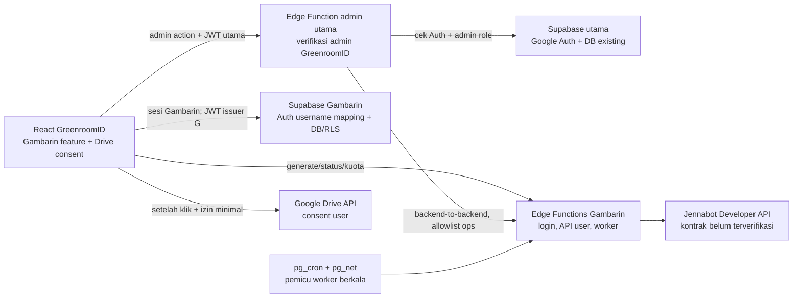
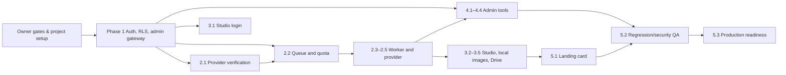

# Rencana Implementasi Gambarin AI MVP

Status: **rencana untuk ditinjau; arsitektur belum final dan belum disetujui Project Owner.** Dibuat pada 26 Oktober 2026 dari `DECISIONS.md`, PRD MVP, `AUTH-ARCHITECTURE.md`, peta kode Job 0.1, dan verifikasi dokumentasi yang dapat diakses. Tidak ada source code atau SQL yang dibuat/diubah pada Job 0.3.

## 1. Rekomendasi arsitektur dan prasyarat

Pertahankan React/Vite GreenroomID dan proyek Supabase utama. Tambahkan satu proyek Supabase Gambarin sebagai issuer Auth serta rumah data/Edge Functions Gambarin. User Gambarin memakai username/password yang diprovisikan admin, dengan sesi JWT dari issuer Gambarin. Jangan masukkan user Gambarin ke Auth proyek utama. Akun Supabase berbeda tidak menjadi identitas silang.

Prasyarat sebelum Phase 1:

1. Project Owner menyetujui proyek kedua, batas layanan Free/pause, rencana operasional jika idle, dan apakah MVP produksi boleh bergantung pada Free.
2. Project Owner memastikan kuota dua proyek aktif belum dipakai akun/organisasi di luar GreenroomID utama. Kuota tersebut berlaku lintas organisasi ketika akun memiliki role Owner/Admin; keadaan akun ini tidak dapat diakses di sesi kerja ini.
3. Setujui mekanisme lintas proyek admin, OAuth Google Drive terpisah, domain/callback, kontak reset akun, dan lokasi/retensi metadata.
4. Jennabot Developer API dan hak penggunaan komersialnya diverifikasi sebelum pekerjaan provider atau generate berbayar.

**Kelayakan Free:** untuk volume awal 40 akun dan 20 job outstanding, batas terpublikasi seperti 50.000 MAU, 500.000 invokasi Edge Function/bulan, 500 MB database per proyek, dan 2 juta pesan Realtime/bulan tampak memadai sebagai anggaran awal. Namun ini bukan jaminan operasi: volume polling, ukuran prompt/log, transfer output, dan kebutuhan uptime harus diukur. Free project dapat dijeda setelah aktivitas database rendah selama tujuh hari; proyek GreenroomID yang aktif tidak menjamin proyek Gambarin tetap aktif. Jika Gambarin harus selalu tersedia bagi pelanggan, Owner perlu menerima risiko pause atau memilih paket operasional tanpa pause.

Sumber plan Supabase yang diperiksa 26 Oktober 2026: [kuota dan billing](https://supabase.com/docs/guides/platform/billing-on-supabase), [project pausing](https://supabase.com/docs/guides/platform/free-project-pausing), [limits Edge Functions](https://supabase.com/docs/guides/functions/limits), [scheduling Edge Functions](https://supabase.com/docs/guides/functions/schedule-functions), dan [password-based Auth](https://supabase.com/docs/guides/auth/passwords). Angka/fitur tetap perlu dicek pada dashboard akun saat setup.

## 2. Hubungan komponen

Tidak ada JWT user yang dipakai silang. Endpoint admin utama menerima token utama dari browser, memverifikasi token dan peran admin pada backend utama, lalu memanggil endpoint admin Gambarin dari server ke server dengan rahasia internal. Endpoint Gambarin hanya menerima operasi allowlist, membuat audit dengan actor UUID admin yang telah divalidasi, dan menggunakan service role hanya di sisi server. Jangan mempercayai role/actor dari payload browser; endpoint internal perlu autentikasi kuat, idempotensi untuk mutasi, batas payload, dan redaksi log.

Endpoint generate user hanya menerima token issuer Gambarin. Edge Function Gambarin memeriksa identitas dan entitlement melalui DB Gambarin. API Jennabot hanya dipanggil worker/backend Gambarin. Service-role dan API key provider tidak pernah dikirim ke browser.

## 3. Batas tanggung jawab proyek

| Bagian | Tanggung jawab |
| --- | --- |
| GreenroomID React dan Supabase utama | Landing page dan layanan existing, Google Auth utama, dashboard admin existing, verifikasi admin pada endpoint admin utama. Tidak menyimpan sesi Gambarin atau menangani generate user. |
| Proyek Supabase Gambarin | Supabase Auth khusus, username lookup, entitlement/paket/kuota/ledger/job/audit Gambarin, RLS, Edge Functions untuk login/API/worker dan secret Jennabot. Tidak menerima Google Auth utama sebagai login pengguna. |
| Integrasi admin lintas proyek | Browser mengirim JWT GreenroomID hanya ke endpoint utama. Endpoint utama menguji user/role admin server-side; server memanggil endpoint allowlist Gambarin. Admin actor disimpan sebagai UUID eksternal dari klaim yang sudah diverifikasi. Tidak ada service key/token internal di browser. |
| Browser user | Sesi Gambarin, prompt, status, hasil lokal IndexedDB, download, dan Drive consent yang diminta user. Bukan sumber kebenaran entitlement, antrian, biaya, atau kuota. |
| Jennabot | Hanya provider untuk generate/status/asset setelah Developer API, harga, model, permission, dan hak penggunaan terbukti. |

`src/App.jsx` memakai sesi utama untuk route privat dan admin; pertahankan route layanan lain. `/GambarinAI` harus dapat dibuka dari route publik tanpa menjadikan user Gambarin sebagai user GreenroomID. Integrasi final tetap mengikuti layout nested yang sudah ada dari Job 0.1.

## 4. Autentikasi dan akun admin

### Login pengguna

1. Admin membuat user hanya melalui UI admin GreenroomID. Endpoint utama memvalidasi sesi Google dan role admin, lalu memanggil endpoint provision Gambarin.
2. Supabase Auth Gambarin menyimpan credential/password hash secara managed. Username unik dipetakan server-side ke email internal acak Auth (tidak dikirim sebagai alamat kontak); tidak simpan password plaintext. Supabase password sign-in memakai email/nomor, maka endpoint login Gambarin perlu memetakan username ke identitas internal dan menukar kredensial pada Auth Gambarin, lalu mengembalikan token sesi. Balasan login generik, rate limited, dan tidak mengungkap username terdaftar.
3. Matikan public signup dan provider OAuth untuk login Gambarin. Hanya server Admin Auth API yang boleh membuat user. Jangan mengandalkan tombol signup yang disembunyikan saja.
4. Client/sesi Auth Gambarin memakai konfigurasi issuer terpisah dan tidak memanggil `supabase.auth` utama untuk login/logout Gambarin. Semua data sensitif dan generate tetap diverifikasi backend.
5. Logout membersihkan sesi Gambarin saja. Nonaktifkan/reset password harus revoke refresh session yang didukung dan status entitlement dicek di backend pada setiap operasi agar sesi/JWT lama tidak mempertahankan akses.

### Administrasi akun

Admin dapat membuat akun, memilih paket, mengaktifkan bonus (mulai masa berlaku saat aktivasi), menonaktifkan, reaktivasi, memperpanjang, reset password, menyesuaikan kuota, serta meninjau status/ledger. Default paket hanya berlaku pada aktivasi baru. Kredensial awal hanya ditampilkan satu kali, tidak dicatat log. Mutasi dan pembacaan rahasia diaudit (aktor, target, aksi, waktu; tidak termasuk password/token).

Endpoint utama membuktikan admin lewat Auth utama dan sumber role server-side (RLS/RPC existing). Endpoint internal Gambarin menolak semua caller selain backend tepercaya. Password baru diberikan lewat kanal manual yang Owner setujui; fitur reset mandiri/email bukan scope MVP.

## 5. Pembagian data dan RLS

Semua tabel Gambarin tinggal di database proyek Gambarin, bukan proyek utama. Desain tabel mengikuti PRD §10; finalisasi skema adalah pekerjaan implementasi tersendiri:

- `gambarin_accounts`: auth user id, username unik, status, activation/expiry, paket, kuota/metadata.
- `gambarin_packages`: durasi/default kuota; perubahan default tidak mengubah entitlement lama.
- `gambarin_quota_ledger`: alokasi, adjustment, konsumsi/release, alasan, job, actor eksternal; append-only bila memungkinkan.
- `gambarin_jobs`: sequence monotonik, waktu server, prompt sementara, status internal/provider, remote ids, attempt, cost, reserved, timestamps.
- `gambarin_config`: limit outstanding=20, concurrency=1 awal, worker pause, allowlist model terverifikasi.
- `gambarin_audit_logs`: admin actor/aksi target; immutable untuk aktivitas admin kritis.
- `gambarin_feedback`: rating/saran opsional.

RLS: akses langsung user Gambarin hanya baris akun/job sendiri; user tidak dapat menulis kuota, status, role, sequence, biaya, remote id, konfigurasi, atau audit. Mutasi kuota/antrian dilakukan lewat transaksi/RPC/backend atomik. Tabel konfigurasi/audit/admin hanya backend service role atau RPC yang grant-nya sempit. Revoke grants default dan uji anon, user Gambarin lain, user disabled/expired, dan admin lintas proyek. Jangan menganggap service role sebagai kontrol RLS.

Untuk validasi user token, gunakan JWT issuer Gambarin pada project Gambarin. Untuk endpoint utama jangan terima token itu. Untuk endpoint admin lintas proyek, hanya main admin function menjadi gateway tepercaya. Tidak mengasumsikan kondisi database produksi saat ini (UNVERIFIED).

## 6. Antrian, kuota, dan worker

Submit job satu gambar: satu transaksi backend mengunci/memeriksa akun dan kuota, memastikan status `active`, masa berlaku valid, outstanding global <20, idempotency key unik, membuat job urutan FIFO berdasarkan waktu server/sequence, dan mereservasi satu foto. Sisa tampil = kuota total − sukses − reservasi aktif. Sukses final mengubah reservasi jadi pemakaian; gagal final atau cancel sebelum provider menerima melepasnya. Admin tidak dapat mengubah urutan FIFO.

Dispatch awal **satu job**. Worker tanpa browser dipicu berkala melalui `pg_cron` + `pg_net` ke Edge Function Gambarin; Edge Function mengambil satu slot/claim atomik, melakukan panggilan provider asinkron secara retry-safe, menyimpan remote job ID, lalu keluar. Polling status/asset berjalan pada pemicu berikut dengan backoff; jangan menahan Edge Function terbuka menunggu generate selesai. Claim harus lease/idempotent agar dua invokasi cron tidak mengirim job ganda. Uji fitur extension, schedule, secret vault/internal auth, retry, dan pemulihan pada proyek yang benar sebelum reliance produksi. Supabase docs mendokumentasikan cron + pg_net dan pola invoke berkala, tetapi bukan SLA job scheduler.

Polling UI dibatasi dan interval melambat ketika tab tersembunyi/idle; Realtime opsional hanya bila perlu dan semua perubahan tetap dicek server. Maksimum 20 outstanding termasuk queued/submitting/running. Naikkan concurrency hanya 2 lalu 3 setelah tes provider membuktikan paralel dan 409/429 dapat diatur. Jika belum ada bukti, serial 1.

## 7. Integrasi `/GambarinAI` dan card landing

- Tambah route publik `/GambarinAI` di `renderPublicRoutes()` pada `src/App.jsx`; hindari mengubah route layanan/Shop/Authenticator. Halaman route menampilkan login atau Studio menurut sesi Gambarin sendiri, bukan `AppContent` user Google.
- Tempatkan UI/client/data hooks Gambarin di `src/features/gambarin/` mengikuti pola lazy loading yang sudah ada.
- Card landing didefinisikan di `HOME_CARD_CONTENT` dan opsi ikon/field terkait di `src/utils/landingContent.js`; renderer `src/pages/LandingPage.jsx` sudah memetakan konfigurasi ke Link. Editor `src/pages/AdminLandingContentPage.jsx` menggunakan metadata tersebut. Tujuan route dikunci aplikasi sesuai DECISIONS §Produk dan akses (1), sementara label/teks/ikon dapat memakai pola content existing.
- Admin: menu di `menuGroups` pada `src/pages/AdminLayout.jsx`, nested child route dan lazy import pada `/admin` di `src/App.jsx`. Semua data admin lewat main admin gateway.

Perubahan kecil, terpisah per tahap. Uji routing untuk sesi Google kosong, Google user non-entitled, Gambarin-only, dan admin GreenroomID supaya tidak ada sesi silang/redirect yang salah.

## 8. IndexedDB dan Drive

Unduh hasil selalu tersedia. Setelah output diterima browser, validasi tipe/ukuran, simpan Blob dan metadata minimal ke IndexedDB pada origin GreenroomID; bila gagal/penuh beritahu user dan tetap sediakan Download. Tidak ada image bytes di Supabase Storage/backend dan tidak ada galeri sinkron antarperangkat.

Simpan ke Drive hanya setelah user memilih aksi. OAuth Drive terpisah dari Supabase Auth dan Google login utama; minta scope minimal memadai (`drive.file` sesuai validasi Google Console), upload file setelah consent, token access sementara di klien, tanpa menyimpan refresh token di server. Konfigurasi OAuth/redirect, status consent, dan API behavior perlu diverifikasi manual. Aset provider bisa kedaluwarsa; jangan menjanjikan pemulihan permanen.

## 9. Breakdown Phase 1–5

Setiap nomor adalah pekerjaan kecil; tunggu hasil/acceptance sebelum pekerjaan bergantung dimulai. Phase 1 tidak dimulai pada Job 0.3.

### Phase 1 — Persiapan Infrastruktur Autentikasi

| Job | Scope | Dependensi | Acceptance |
| --- | --- | --- | --- |
| 1.1 Owner setup dan boundary checklist | Konfirmasi slot/proyek, plan, domain, pemilik secrets, operasional pause, email internal username, Drive OAuth | Persetujuan owner | Checklist terisi; proyek tidak dibuat Codex tanpa instruksi; trade-off uptime Free disepakati. |
| 1.2 Proyek dan Auth Gambarin | Owner membuat/menyetujui proyek; config email/password, signup publik off, redirect/domain, project secrets | 1.1 | Issuer/Auth Gambarin terpisah; login Google utama tidak berubah; tidak ada secret di repo/frontend. |
| 1.3 Fondasi data, RLS dan audit | Skema akun/paket/ledger/audit minimum, role grants, RPC transaksi dasar | 1.2 | Tes anon/user sendiri/user lain/expired/disabled/admin; tidak bisa mengubah quota/status sendiri; audit tidak bisa diubah user. |
| 1.4 Username login dan lifecycle akun | Endpoint provision/login/reset/disable/revoke, mapping username, rate limit dan generic errors | 1.2–1.3 | Hanya admin bisa provision/reset; username login berfungsi; signup publik ditolak; token lintas issuer ditolak; disable memblokir request baru. |
| 1.5 Admin gateway lintas proyek | Main function validasi JWT dan role admin; pemanggilan server-to-server operasi allowlist Gambarin | 1.2–1.4 | Client non-admin ditolak; actor tidak bisa spoof; secret hanya backend; retry mutasi idempotent/audit. |

### Phase 2 — Provider, kuota dan worker

| Job | Scope | Dependensi | Acceptance |
| --- | --- | --- | --- |
| 2.1 Jennabot contract gate | Verifikasi docs/key/permissions/models/prices/balance/create/status/result/errors/idempotency/concurrency/retention/CORS/rights, tanpa generate berbayar | Akses docs/provider dan Owner | Bukti resmi tertaut per capability; item belum terbukti UNVERIFIED; model tak dikenal tidak eligible. |
| 2.2 Queue/ledger transaction | Submit idempotent, capacity 20, FIFO, atomic reserve/commit/release | 1.3 dan kontrak request 2.1 yang diketahui | Uji race/double-submit; kapasitas tidak lewat 20; satu request memesan satu foto. |
| 2.3 Worker serial dispatch | pg_cron/pg_net + function worker claim satu job, secret aman, remote create/status | 2.1–2.2 dan 1.2 | Tidak tergantung browser; job tidak terkirim ganda; retry/timeout tidak membuat tagihan ganda; concurrency 1. |
| 2.4 Status, asset dan error recovery | Poll/backoff, terminal state, resolve asset/retensi, release reserve final | 2.3 | 409/429/timeout/failure sesuai bukti; gagal final lepaskan reservasi; prompt/temp URL dibersihkan sesuai retensi. |
| 2.5 Model/cost/balance admin config | Allowlist model ≤2 credit verified, fallback, health/balance jika supported | 2.1, 2.3 | Tidak ada request berbayar jika model/harga unknown; tidak mengarang saldo; fallback hanya setelah verifikasi. |

### Phase 3 — Studio pengguna

| Job | Scope | Dependensi | Acceptance |
| --- | --- | --- | --- |
| 3.1 Route dan auth UI | `/GambarinAI`, login username/password, sesi/expiry/logout terpisah | 1.4 | AC-01/02 terpenuhi; sesi GreenroomID dan Gambarin tidak saling mengganti. |
| 3.2 Studio dan kuota | Prompt-only UI, akun/entitlement, generate, queue/status/errors | 2.2–2.4, 3.1 | Status/remaining berasal dari backend; expired/disabled/zero quota tidak submit. |
| 3.3 IndexedDB dan Download | Blob hasil, gallery lokal, handling unsupported/full, Download | 2.4, 3.2 | Tidak ada gambar di backend; download bekerja jika IndexedDB gagal. |
| 3.4 Drive OAuth | Consent saat klik, scope minimum, upload terpilih | 3.3 dan Owner OAuth setup | Consent terpisah; Drive action tidak mengubah dua sesi app; tanpa refresh token tersimpan server. |
| 3.5 UX/responsive/feedback | Mobile states, optional rating prompt | 3.2–3.4 | Error/loading/queue full/expired jelas; feedback bisa dilewati dan tidak blokir hasil. |

### Phase 4 — Dashboard admin Gambarin

| Job | Scope | Dependensi | Acceptance |
| --- | --- | --- | --- |
| 4.1 Admin overview | KPI account, expiry, queue, provider status/balance available | 1.5, 2.4–2.5 | Semua metrik dari backend; unsupported balance ditandai unavailable. |
| 4.2 Accounts/packages | CRUD operasi yang diizinkan: provision, activate, disable/reactivate, duration/quota/reset | 1.5 | Akun/kredensial tidak bocor; default baru tidak mengubah akun aktif; semua mutasi audit. |
| 4.3 Queue/provider controls | FIFO queue, cancel queued, pause/resume dispatch, health warnings | 2.3–2.5, 1.5 | Tidak ada reordering; running job tidak dinyatakan cancel/refund tanpa provider bukti. |
| 4.4 Audit and usability | Search/filter/action history, permission tests | 4.1–4.3 | Setiap perubahan kritis immutable audit; admin nonaktif tidak bisa lanjut via token lama. |

### Phase 5 — Integrasi, QA dan kesiapan MVP

| Job | Scope | Dependensi | Acceptance |
| --- | --- | --- | --- |
| 5.1 Landing card dan route polish | Card keempat via landing metadata, ikon, tujuan `/GambarinAI`, editor content bila sesuai | 3.1 dan konteks Job 0.1 | Card tampil; route tepat; tiga route layanan existing tidak berubah. |
| 5.2 Security/regression acceptance | Auth silang, RLS, admin, kuota races, cron recovery, Drive, mobile/browser, regression layanan existing | Phase 1–5 implementation complete | AC PRD §13 terpenuhi dan bukti tes dicatat; tidak ada claim tanpa runtime evidence. |
| 5.3 Production readiness | Secrets/domain/CORS/OAuth, backup/retention/alerts, Jennabot rights/cost, project plan/availability, rollback | 5.2 + all owner gates | Checklist Owner lulus; secrets hanya server; deploy tetap menunggu instruksi/approval terpisah. |

## 10. Urutan dependensi

Parallel work is safe only between isolated docs/UI jobs after interfaces are agreed; schema/auth/API gates must precede dependent UI and admin operations. Do not start Phase 1 until Owner approves project-slot, plan and architecture conditions.

## 11. Manual checklist Project Owner

- [ ] Approve separate Gambarin Supabase project and name the project/organization owner.
- [ ] Check active project slots across all organizations where Owner/Admin; confirm second Free slot or choose paid plan. Confirm existing GreenroomID project plan.
- [ ] Decide whether Free pause is acceptable; select monitoring/resume owner or paid availability plan.
- [ ] Confirm production domains, allowed origins, Auth redirect URLs, secret ownership and incident contact.
- [ ] Approve username policy and secure one-time credential delivery/reset process.
- [ ] Approve location/retention for prompts, metadata, audit entries, quota history and remote asset IDs.
- [ ] Configure Google OAuth Drive client/consent screen and minimum scopes separate from main Google Auth; verify production verification requirements.
- [ ] Provide official Jennabot Developer docs access, API key setup/permissions without sharing key in chat/repo, written multi-customer use permission, confirmed credit budget/top-up operator.
- [ ] Confirm production uptime expectation, operational response for provider failure, queue pause and paused Supabase project.
- [ ] Approve policy for account reactivation/expiry semantics and admin actor/audit visibility.

## 12. Provider verification status (Job 0.3)

**Terverifikasi untuk Jennabot pada sumber yang dapat diakses: tidak ada endpoint atau harga.** `https://jennabot.pro/docs` yang ditunjuk `DECISIONS.md` dan `JENNA-API-VERIFICATION.md` tidak dapat dibuka melalui akses web sesi ini; pencarian juga tidak menemukan dokumentasi resmi Jennabot yang dapat dicocokkan. Referensi serupa dari provider lain tidak digunakan sebagai bukti. Tidak ada request API/generate berbayar yang dikirim.

| Kapabilitas | Bukti/status sekarang | Rencana aman |
| --- | --- | --- |
| API key, permission/scope | UNVERIFIED; format/permission tidak diketahui | Owner/provider memberi docs resmi dan key dibuat/diuji backend saja. |
| Daftar model, harga aktual per output | UNVERIFIED; tidak ada model eligible yang dapat dinamai | Allowlist tetap kosong sampai response resmi dibuktikan; batas biaya >2 atau unknown ditolak. |
| Endpoint submit, idempotensi, job ID | UNVERIFIED; tidak ada method/path/schema diklaim | Jangan panggil generate sampai kontrak aman diketahui; test hanya sandbox/non-billed atau harga diketahui tanpa dispatch. |
| Status, result, asset retrieve/retensi/CORS | UNVERIFIED | Uji read/status dan download resmi; simpan hanya remote IDs/URL sementara yang diperlukan. |
| Balance dan top-up | UNVERIFIED | Dashboard menampilkan “Tidak tersedia” sampai endpoint terbukti; top-up tetap manual melalui URL resmi yang dikonfirmasi Owner. |
| Error 409/429/timeout/refund | UNVERIFIED | Jangan menganggap status/refund; implementasi mengikuti kontrak dan uji resmi. |
| Parallel capacity | UNVERIFIED | Tetapkan concurrency 1; uji 2 lalu 3 hanya dengan izin/test account setelah kontrak terbukti. |
| Fallback ≤2 kredit dan hak multi-customer | UNVERIFIED | Tidak ada fallback aktif dan tidak launch berbayar sampai tarif dan izin tertulis disetujui. |

Panduan teknis global yang aman untuk MVP: FIFO server-side, max outstanding 20, concurrency 1, retry idempotent, jangan resubmit saat hasil create belum diketahui, jangan mengurangi kuota final sebelum sukses, dan lepas reservasi hanya pada gagal final atau cancel sebelum provider menerima sesuai PRD/DECISIONS. Ini aturan produk, bukan klaim perilaku Jennabot.

## 13. Blocker dan keputusan Owner

1. **Auth architecture pending approval:** proyek kedua memisahkan issuer, tetapi slot Free akun belum diketahui dan Free dapat pause. Keputusan: approve proyek kedua + risiko/plan, atau kembalikan untuk desain alternatif secara eksplisit.
2. **Cross-project setup unverified:** URL/keys, internal admin endpoint authentication, CORS/origin, JWT verification, service-role reach, audit RPC, dan project Auth configs harus diuji di proyek yang disetujui.
3. **Jennabot hard blocker untuk Phase 2 dan launch:** seluruh Developer API details, model cost ≤2, balance, job/status/result, concurrency, errors, retention/CORS, dan hak melayani banyak customer belum terbukti.
4. **Operasional Free:** scheduler bukan pengganti uptime guarantee; pemicu cron/pg_net harus dibuktikan pada proyek; project idle pause mengakibatkan login/Studio/worker unavailable. Owner memilih accept dengan runbook pemulihan atau plan tanpa pause.
5. **Google Drive:** OAuth redirect/scope/access verification dan pemisahan sesi harus diperiksa pada client/domain produksi.

### Sumber teknis resmi yang diperiksa

- [Supabase billing dan batas dua proyek Free](https://supabase.com/docs/guides/platform/billing-on-supabase)
- [Supabase Free project pausing](https://supabase.com/docs/guides/platform/free-project-pausing)
- [Supabase Edge Function limits](https://supabase.com/docs/guides/functions/limits)
- [Supabase cron memanggil Edge Functions](https://supabase.com/docs/guides/functions/schedule-functions)
- [Supabase password-based Auth](https://supabase.com/docs/guides/auth/passwords)
- [Jennabot docs yang ditetapkan proyek](https://jennabot.pro/docs) — tidak dapat diakses dari sesi verifikasi ini; tidak ada klaim endpoint/provider diambil darinya.
